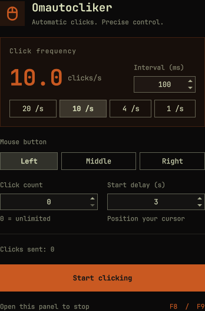

# Omautocliker

[](https://github.com/Roddygithub/omautocliker/actions/workflows/ci.yml)



A small native auto-clicker for **Omarchy Quattro / Hyprland / Wayland**.
Built from scratch with QML and JavaScript; no compilation or bundled click engine.

- Left, middle and right clicks at the current pointer position.
- Adjustable interval, with 20/10/4/1 clicks-per-second presets.
- A finite click count, or unlimited with `0`.
- A 1–10 second countdown before clicking (default: 3 seconds).
- Saved preferences, a shared service across monitors and a themed bar icon.
- Opening the panel or right-clicking the bar icon stops clicking.
- Follows Omarchy's theme, number formatting and selected language. All 50 languages currently offered by Omarchy are included, with automatic
  selection and right-to-left layout.

## Install

Requires Omarchy Quattro with `qs.Ui`, `qs.Commons.Translations`, `ShellIpc` and
`bar.shell.serviceFor`, Quickshell with `QtCore.Settings`, and **ydotool 1.0.x**.
The plugin runs as your user and never installs packages or changes permissions.

```sh
omarchy pkg add ydotool
omarchy plugin add https://github.com/Roddygithub/omautocliker.git --enable
```

Prepare `ydotoold` before starting a click sequence:

```sh
systemctl --user enable --now ydotool.service
systemctl --user status ydotool.service
```

The daemon needs access to `/dev/uinput`. If it fails, inspect:

```sh
journalctl --user -u ydotool.service -n 30 --no-pager
getfacl /dev/uinput
```

If your distribution does not already grant access, an administrator can use a
dedicated group and udev rule (only do this if needed):

```sh
sudo groupadd -f uinput
sudo usermod -aG uinput "$USER"
printf '%s\n' 'KERNEL=="uinput", GROUP="uinput", MODE="0660", OPTIONS+="static_node=uinput"' \
  | sudo tee /etc/udev/rules.d/80-omautocliker-uinput.rules
sudo modprobe uinput
sudo udevadm control --reload-rules
sudo udevadm trigger --subsystem-match=misc --sysname-match=uinput
```

Log out completely and log back in for group membership to apply, then restart
`ydotool.service`. Members of this group can create virtual input devices.
Never make the device or daemon socket world-writable. The daemon socket should
be accessible only to the intended user. Custom installations must expose the
same `YDOTOOL_SOCKET` to the daemon and the Omarchy shell.

From a checkout, `bin/doctor` checks connectivity using button `0x00`, which
sends no button press or release. `bin/install` is a local-development installer:
it backs up an existing plugin under `~/.local/state/omautocliker/backups`, copies
the QML files and enables the bar entry. Updating an existing local copy
restarts the Omarchy shell to clear cached QML (other applications remain open). The normal marketplace installation uses the
`omarchy plugin add` command above.

## Global shortcuts

Check for existing F8/F9 bindings first (`omarchy menu keybindings --print`).
Add these lines to `~/.config/hypr/bindings.lua` if the keys are available:

```lua
o.bind("F8", "Omautocliker toggle", "omarchy-shell omautocliker toggle")
o.bind("F9", "Omautocliker stop", "omarchy-shell omautocliker stop", { locked = true, ignore_mods = true })
```

Run `hyprctl reload` and `hyprctl configerrors`. F9 is an explicit stop, including
while locked; F8 does not start a sequence from the lock screen. The plugin does
not add or overwrite keybindings automatically.

## Controls and commands

Click the mouse icon to open settings. Opening the panel always stops the
sequence. Choose a rate, button, count and delay, then press **Start clicking**.
The countdown lets you position the pointer. Escape closes the panel. Tab moves
through controls. Verify the stop shortcut before using unlimited mode.

```sh
omarchy-shell omautocliker status
omarchy-shell omautocliker configure 100 left 20 3
omarchy-shell omautocliker start
omarchy-shell omautocliker stop
omarchy-shell omautocliker toggle
omarchy-shell shell summon roddy.omautocliker '{}'
omarchy-shell shell hide roddy.omautocliker
```

`configure` takes interval in milliseconds (10–3,600,000), button
(`left|right|middle`), click limit (0–1,000,000) and delay in seconds (1–10).
It rejects invalid values and changes while a sequence or click is active.
`status` returns JSON, including phase, successful commands, countdown,
configuration and a bounded backend diagnostic.

Only one click process can run at a time; a slow backend reduces the rate
instead of queuing clicks. CPS is a maximum, not a real-time guarantee. Stop
allows one in-flight press/release pair to finish. Errors stop the sequence.
A hung process stops scheduling after 2 seconds and blocks another start until
it exits. Disabling the plugin or restarting the shell removes its click loop;
**clicking never resumes automatically**. The separate `ydotoold` input daemon
remains running.

Preferences live in `${XDG_CONFIG_HOME:-~/.config}/omautocliker.ini`. There is
no runtime network access, telemetry, download, privileged helper or background
clicking service outside the Omarchy shell. The counter records successful
commands; it cannot confirm delivery to an arbitrary target application.

## Tests

```sh
bin/test
# With a Wayland session: service tests plus UI interactions and translation.
OMAUTOC_TEST_LANG=en bin/test
OMAUTOC_TEST_LANG=fr bin/test
# Full locale coverage and rendering checks:
OMAUTOC_TEST_LANG=all bin/test
```

Requires Node.js, jq, Quickshell and an Omarchy source/install tree
(`OMARCHY_PATH`, default `/usr/share/omarchy`). These tests isolate preferences
and use a fake backend: **no mouse clicks are injected**. A Wayland session is
required to exercise the panel. CI loads all 50 languages in an isolated headless
Sway session, against a pinned official Omarchy runtime, without input devices.
It also checks the native Omarchy manifest validator, JavaScript assertions,
ShellCheck and Python syntax. CI does not replace physical desktop testing.

The opt-in real desktop test is `python tests/live.py`. It requires an unlocked
Hyprland session, the installed plugin, configured shortcuts and working
`ydotoold`. It opens a harmless test window, injects bounded sequences, checks
all three buttons and F8/F9, disables/re-enables the plugin and restarts the
shell. It restores preferences, pointer position and the active window on exit.
See [the recorded desktop results](tests/live-results.json).

## Remove

```sh
omarchy-shell omautocliker stop
omarchy plugin remove roddy.omautocliker
```

Remove the two shortcut lines if you added them, then reload Hyprland.
Preferences remain available; delete `omautocliker.ini` to reset them. The
`ydotool` package and daemon remain installed for other tools. Removing a group
or udev rule created solely for this plugin is a separate administrator action.

## License and maintenance

MIT for the plugin. `ydotool` is an external AGPL-3.0 program, not bundled or
copied into this repository. The interface uses Omarchy's public components;
translations live in `i18n/` (initial machine-assisted translations with
context-sensitive mouse labels and placeholders checked; native-speaker improvements
are welcome), the click lifecycle in `Service.qml`, validation
and command arguments in `Model.js`.

[Documentation française](docs/README.fr.md) ·
[Omarchy plugin contract](https://plugins.omarchy.org/develop.html) ·
[ydotool manual](https://man.archlinux.org/man/ydotool.1.en)
