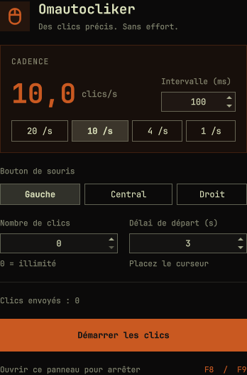

# Omautoclicker



Un autoclicker pour **Omarchy Quattro / Hyprland / Wayland**, intégré à la barre.
Code neuf en QML/JavaScript, sous licence MIT ; `ydotool` reste un programme
externe, sous sa propre licence. Aucun moteur tiers copié, aucune compilation.

## Fonctionnement

- Clic gauche, droit ou central à la position actuelle du curseur.
- Intervalle de 10 ms à une heure, équivalent en CPS affiché.
- Nombre limité de clics, ou illimité avec `0`.
- Décompte de 1 à 10 secondes avant le premier clic ; défaut : 3 secondes.
- Réglages mémorisés ; état actif jamais restauré au démarrage.
- Un seul service pour tous les écrans, icône de souris avec point d’activité dans la barre.
- Ouvrir le panneau arrête les clics ; clic droit sur l’icône = arrêt.
- Interface traduite dans les 50 langues proposées par Omarchy, sélection automatique et mise en page de droite à gauche.
- Cadence en grand, préréglages 20/10/4/1 clics par seconde, intervalle saisi manuellement en secondes (0,01–3600) et icône de souris.

Une seule commande de clic est en cours à la fois. Un moteur lent réduit la
cadence au lieu d’accumuler les commandes : les CPS affichés sont un plafond,
pas une garantie de temps réel. Chaque clic est une paire appui/relâchement sans
délai interne. Après l’arrêt, une paire déjà envoyée peut encore se terminer.
Une erreur arrête la séquence ; un moteur bloqué arrête la planification après
2 secondes et interdit un nouveau départ tant que le processus ne termine pas.
Désactiver le plugin ou quitter le shell supprime sa boucle ; aucun démon de
clics ni tâche récurrente ne restent en arrière-plan. `ydotoold`, lui, reste un
service indépendant.

## Installation locale

Nécessite Omarchy Quattro avec les API `qs.Ui`, `qs.Commons.Translations`,
`ShellIpc` et `bar.shell.serviceFor`, Quickshell avec `QtCore.Settings`, et
`ydotool` 1.0.x avec son démon `ydotoold` accessible au compte utilisateur.

```sh
omarchy pkg add ydotool
# Configurer ydotoold selon la section suivante avant d’envoyer des clics.
bin/doctor
bin/install
```

`bin/install` copie uniquement les fichiers du plugin dans
`~/.config/omarchy/plugins/roddy.omautoclicker`, puis l’active à droite dans la
barre. Lors d’une mise à jour, il arrête/désactive le plugin et sauvegarde
l’ancienne version sous `~/.local/state/omautoclicker/backups/`. Une mise à jour locale redémarre le shell pour vider le cache QML. Il n’installe
aucun paquet, ne change aucune permission et n’ajoute aucun raccourci.

### Préparer ydotoold

Le paquet Arch fournit un service **utilisateur** :

```sh
systemctl --user enable --now ydotool.service
systemctl --user status ydotool.service
journalctl --user -u ydotool.service -n 30 --no-pager
```

Si le journal indique que `/dev/uinput` est inaccessible, il faut d’abord
configurer cet accès. Exemple avec un groupe dédié, à exécuter une seule fois
avec les droits administrateur :

```sh
sudo groupadd -f uinput
sudo usermod -aG uinput "$USER"
printf '%s\n' 'KERNEL=="uinput", GROUP="uinput", MODE="0660", OPTIONS+="static_node=uinput"' \
  | sudo tee /etc/udev/rules.d/80-omautoclicker-uinput.rules
sudo modprobe uinput
sudo udevadm control --reload-rules
sudo udevadm trigger --subsystem-match=misc --sysname-match=uinput
```

Se déconnecter complètement puis se reconnecter pour appliquer le groupe,
puis redémarrer le service utilisateur. Ce groupe autorise la création de
périphériques d’entrée virtuels : seuls les comptes choisis doivent y appartenir.
Ne pas rendre `/dev/uinput` ou le socket accessibles à tous avec `chmod 666`.

```sh
systemctl --user restart ydotool.service
bin/doctor
```

Avec une installation personnalisée de `ydotoold`, le plugin hérite de
`YDOTOOL_SOCKET` depuis le processus Omarchy shell. Le client et le démon doivent
utiliser le même socket, accessible au seul compte concerné. `bin/doctor`
envoie la commande neutre `click 0x00` : aucun appui ni relâchement de bouton.

### Installation effectuée sur cette machine

Le 7 novembre 2026, faute d’authentification administrateur à distance, les deux
binaires du paquet officiel Arch `ydotool 1.0.4-2` ont été installés dans
`~/.local/bin`. L’archive du miroir Omarchy a été vérifiée avec `pacman-key` :
signature valide de T.J. Townsend, clé
`54C1FD273361EA514A237793F296BDE50368C6CE`. Cette installation utilisateur
n’est pas enregistrée dans pacman ; une future mise à jour doit remplacer ces
deux binaires, ou passer à l’installation système.

Le service `omautoclicker-ydotool.service` est activé dans systemd utilisateur
(modèle dans `support/`). Il démarre à la connexion, utilise le socket
`/run/user/1000/.ydotool_socket` en mode `0600`, et profite de l’ACL existante
sur `/dev/uinput`. Aucun groupe ni aucune règle udev n’a été modifié.

```sh
systemctl --user status omautoclicker-ydotool.service
systemctl --user restart omautoclicker-ydotool.service
```

Pour retirer cette installation spécifique : désactiver ce service, supprimer
son fichier sous `~/.config/systemd/user/`, puis les deux binaires sous
`~/.local/bin`, et exécuter `systemctl --user daemon-reload`.

### Raccourcis globaux

Ajouter dans `~/.config/hypr/bindings.lua`, après avoir vérifié que F8/F9
ne sont pas déjà utilisés (`omarchy menu keybindings --print`) :

```lua
o.bind("F8", "Omautoclicker démarrer/arrêter", "omarchy-shell omautoclicker toggle")
o.bind("F9", "Omautoclicker arrêt", "omarchy-shell omautoclicker stop", { locked = true, ignore_mods = true })
```

Puis `hyprctl reload` et `hyprctl configerrors`. F9 est l’arrêt explicite,
y compris sur l’écran verrouillé ; F8 ne démarre pas de séquence depuis cet écran.
Le délai permet de placer le curseur avant le premier clic. Configurer et
vérifier l’arrêt avant de lancer une séquence illimitée.

## Commandes

```sh
omarchy-shell omautoclicker status
omarchy-shell omautoclicker configure 100 left 20 3
omarchy-shell omautoclicker start
omarchy-shell omautoclicker stop
omarchy-shell omautoclicker toggle
omarchy-shell shell summon roddy.omautoclicker '{}'
omarchy-shell shell hide roddy.omautoclicker
```

`configure` prend : intervalle en ms, `left|right|middle`, limite, délai en s.
Il refuse les valeurs invalides et les changements pendant une séquence.
`status` renvoie JSON, dont `phase`, `count`, `remaining`, `error` et le
diagnostic stderr borné à 1 000 caractères. Le compteur représente les commandes
réussies, sans pouvoir confirmer leur réception par l’application cible.

Les préférences sont stockées dans `${XDG_CONFIG_HOME:-~/.config}/omautoclicker.ini`.
Ni réseau, ni télémétrie, ni téléchargement au fonctionnement du plugin.

## Tests et maintenance

```sh
bin/test
# Depuis une session Wayland : inclut le chargement et le cycle du panneau réel.
WAYLAND_DISPLAY=wayland-1 bin/test
# Capture du contenu réel du panneau, avec le moteur factice :
WAYLAND_DISPLAY=wayland-1 OMAUTOC_SCREENSHOT="$PWD/assets/preview.png" bin/test
```

Nécessite Node.js pour les assertions JS, Omarchy et Quickshell pour les tests
d’intégration. Les tests isolent les préférences dans un dossier temporaire,
utilisent un faux `ydotool` et **n’injectent aucun clic**. Le test d’interface
ouvre brièvement son panneau dans la session Wayland ; les tests du service
s’exécutent sans affichage. Couverture : validation, trois boutons, limite
exacte, moteur lent sans chevauchement, arrêt du décompte et d’une séquence,
moteur absent/en erreur, sauvegarde et traductions.

- `Model.js` : validation et arguments du moteur, sans accès système.
- `Service.qml` : préférences, cycle de vie, timers, processus et IPC.
- `BarWidget.qml` : indicateur et accès au service partagé.
- `ClickPanel.qml` : réglages et commandes, avec les composants publics Omarchy.
- `i18n/` : catalogues des 50 langues Omarchy.

### Tests réels (sur cette machine)

```sh
python tests/live.py
```

Test volontaire avec injection réelle : ouvre une fenêtre sans action et place
le curseur dedans, puis vérifie 5 appuis/relâchements de chaque bouton,
l’annulation du décompte, les touches F8/F9 injectées via ydotool, la
désactivation/réactivation et le redémarrage réel du shell sans reprise des
clics. Toutes les séquences ont une limite de secours de 20 clics. Le pointeur,
la fenêtre active et les préférences sont restaurés en sortie ; le plugin reste
activé et arrêté. Le rapport est écrit dans `tests/live-results.json`.
Ce test nécessite la session Hyprland déverrouillée et l’installation du plugin.
Il redémarre la barre et les panneaux du shell : les autres applications restent
ouvertes.

## Désinstallation

```sh
omarchy-shell omautoclicker stop
omarchy plugin remove roddy.omautoclicker
```

Supprimer les deux lignes F8/F9 si elles ont été ajoutées, puis recharger
Hyprland. Les préférences restent conservées ; supprimer `omautoclicker.ini`
pour les effacer. Le paquet et le service `ydotool` restent installés pour les
autres outils éventuels. Si le groupe et la règle udev ont été créés uniquement
pour ce plugin, leur retrait est une opération administrateur séparée.

## Publication

Le dépôt public contient le `manifest.json` attendu par le marketplace, version 0.1.0,
ID `roddy.omautoclicker`. Il n’est pas encore publié : avant de proposer son
référencement, publier le dépôt GitHub, puis
suivre le [guide de publication](https://plugins.omarchy.org/publish.html).

Références : [contrat plugin Omarchy](https://plugins.omarchy.org/develop.html),
[ydotool](https://man.archlinux.org/man/ydotool.1.en),
[ydotoold](https://man.archlinux.org/man/ydotoold.8.en).
